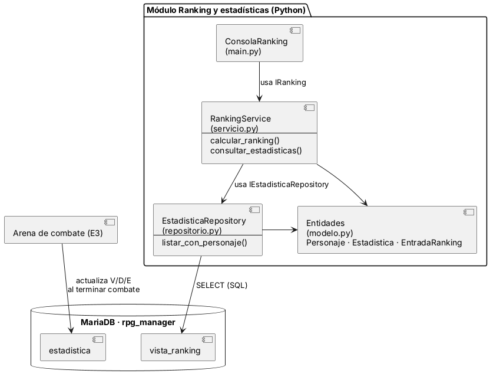

# 16 · Código fuente y componentes — Módulo Ranking

**Equipo E5 · Rol RUP:** Implementador + Integrador · **Iteración:** C1
**Dueños:** Juan Delgado (código y pruebas) · David Rivera (componentes, integración y README)

Componente ejecutable en Python 3.10+ (sin dependencias externas) que calcula el ranking de personajes de RPG Manager ordenándolos por puntaje.

## Cómo ejecutarlo
```bash
cd rup/E5-ranking/03_codigo_fuente
python main.py               # top 10 general
python main.py Mago          # top 10 de Magos
python main.py Guerrero 3    # top 3 de Guerreros
python -m unittest discover -s tests -v   # 13 pruebas
```

Salida esperada (`python main.py`):
```
=== RANKING GENERAL (top 10) ===
 #  Personaje  Clase       V   D   E  Pts
 1  Eldrin     Mago        9   1   0   27
 2  Sylva      Arquero     8   1   1   25
 3  Torvak     Guerrero    8   2   1   25
 4  Brena      Guerrero    8   3   1   25
 5  Merlina    Mago        3   5   2   11
 6  Robin      Arquero     1   4   0    3
```

## Qué casos de uso y requisitos implementa

| Requisito / CU | Dónde se implementa | Prueba que lo verifica |
|---|---|---|
| **CU-R01 Consultar ranking** | `RankingService.calcular_ranking()` + `main.py` | todas las `test_rf_r01_*`, `test_rf_r03_*`, `test_rf_r05_*` |
| **CU-R02 Consultar estadísticas de personaje** | `RankingService.consultar_estadisticas()` | `test_rf_r04_*`, `test_cu_r02_a2_personaje_inexistente` |
| RF-R01 Orden por puntaje desc., solo con ≥ 1 combate | `servicio.py` (filtro + `sort`) | `test_rf_r01_orden_por_puntaje_descendente`, `test_rf_r01_excluye_personajes_sin_combates` |
| RF-R02 Puntaje = 3V + 1E | `Estadistica.puntaje` en `modelo.py` | `test_rf_r02_formula_de_puntaje` |
| RF-R03 Filtro por clase | parámetro `clase` | `test_rf_r03_filtro_por_clase`, `test_rf_r03_clase_invalida` |
| RF-R04 Estadísticas y % victorias | `Estadistica.porcentaje_victorias` | `test_rf_r04_estadisticas_de_personaje` |
| RF-R05 Top N | parámetro `top` | `test_rf_r05_top_n`, `test_top_invalido` |

**Regla de desempate** (definida con el cliente): puntaje ↓ → victorias ↓ → derrotas ↑ → nombre A-Z.

## Componentes

| Componente | Archivo | Responsabilidad |
|---|---|---|
| ConsolaRanking | `main.py` | Interfaz de consola y datos de demostración |
| RankingService | `ranking/servicio.py` | Lógica del ranking (CU-R01, CU-R02) |
| EstadisticaRepository | `ranking/repositorio.py` | Acceso a datos: en memoria (C1) y MariaDB (C2) |
| Entidades | `ranking/modelo.py` | `Personaje`, `Estadistica`, `EntradaRanking` |



Fuente del diagrama: `diagrama_componentes.puml`.

## Trazabilidad con otros artefactos
- Clases y métodos = los del **diagrama de clases de diseño** (eslabón, ver `../00_eslabon_trazabilidad.md`).
- Atributos = columnas de las tablas `personaje` y `estadistica` del **modelo de datos** (`../02_modelo_datos.sql`).
- Las pruebas unitarias son insumo para el **Plan y casos de prueba** de E6.
